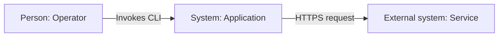
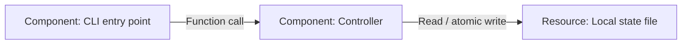
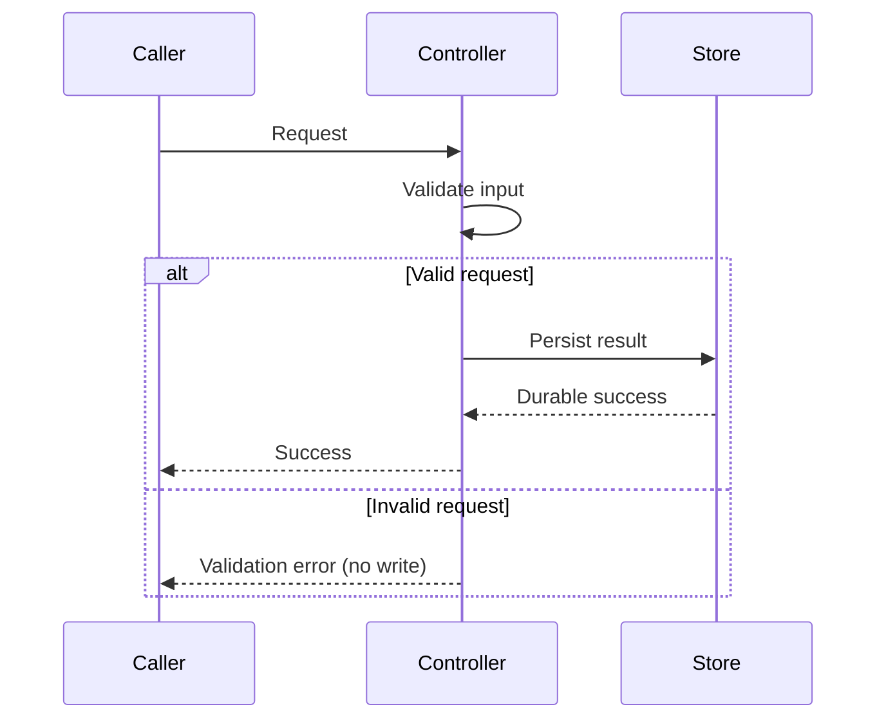

# Architecture, diagrams and resource relationships

These templates need no website or renderer to understand. Replace every illustrative
node, edge and row with facts from the project. Do not imply the target project has
an API, database, worker or network unless its code establishes that fact. Prefer an
existing diagram format; otherwise use simple, broadly supported Mermaid flowcharts
and sequence diagrams. No Mermaid installation or hosted service is required to write
and review their source. Rendering requires a compatible local viewer and is optional
unless repository policy says otherwise.

## docs/architecture.md template

````markdown
# Architecture

## Scope and Responsibilities
<System purpose, users, external dependencies and boundaries.>

## System Context
<Title: System context for PROJECT. Arrows show directed interactions; nodes are
labeled by role. Text equivalent: the operator invokes the application, which calls
an external service. Replace this illustrative flow with the real one.>



## Components and Durable Resources
<Title: Runtime components for PROJECT. State which components share a process and
which are independently deployed. A C4 container means application/data store, not
necessarily a Docker container. Text equivalent: a CLI invokes a controller, which
reads and writes local state. Replace these examples with actual components.>



## Main Flow
<Explain the order, input validation, side effects, failures and completion boundary.
Use a sequence diagram when order matters; otherwise concise text is sufficient.>

## Source Map
| Component | Responsibility | Definition / entry point |
| --- | --- | --- |
| <actual component> | <responsibility> | <relative source link and stable symbol> |

## Boundaries and Limitations
<Trust boundaries, persistence and concurrency semantics actually established by the
implementation. Unknowns and unverified assumptions must be explicit.>

## Related Documentation
- [Resources](resources.md)
````

## Sequence diagram example

Include this pattern only for an actual ordered flow; adapt it instead of copying
an invented transaction into the project documentation.



Text equivalent: the controller validates the request, writes only valid input, waits
for the store's completion and then returns success; invalid input returns an error
without writing. Add storage failure/retry branches only if implemented. Do not label
an acknowledgement "durable" unless the actual store guarantees that boundary.

## docs/resources.md template

```markdown
# Resources and Relationships

## Inventory
| Resource / component | Responsibility | Definition / source | Dependencies / consumers | Interface / protocol | Lifecycle / ownership | Persistence / security boundary |
| --- | --- | --- | --- | --- | --- | --- |
| <actual resource> | <purpose> | <relative source link and symbol> | <actual callers/dependencies> | <function/API/file format> | <creator, updates, cleanup> | <durability, permissions, trust> |

## Relationships
<Explain relationship direction, data ownership and flow. Link the architecture
view; add an entity/resource diagram only when it clarifies real relationships.>

## Failure and Recovery
<Actual error visibility, partial progress, retry/idempotency behavior, recovery and
safe cleanup boundaries. Mark unsupported/unknown guarantees explicitly.>
```

A resource can be a file, process, API, store, queue or infrastructure object. Do not
force a cloud-resource interpretation onto a local tool. Avoid recording live secrets,
account IDs or private deployment payloads in the map.

## Diagram review rules

- Give every diagram a title/scope in surrounding text. Use consistent stable node IDs,
  quoted descriptive labels and directed labeled arrows; explain non-obvious notation
  in a legend. Label protocols/operations instead of unexplained "uses" links.
- Keep abstraction levels clear: a folder/import dependency is not necessarily a runtime
  component or service call. Trace relationships through definitions and callers.
- Link nodes/table entries to source paths and stable symbols. Preserve editable source;
  do not require an opaque image or network renderer to maintain a diagram.
- Keep diagrams and resource tables synchronized when nodes, dependencies or lifecycles
  change. Link views instead of duplicating graphs. Include adjacent text/table
  equivalents for accessibility and offline/plain-text readers.
- Validate syntax using existing local tooling when available. Without a renderer,
  review fence balance, diagram type, IDs, participant declarations, arrows and block
  endings; report `Rendering not verified (renderer unavailable)`, not "rendered".
  Do not install tooling to hide this limitation or upload private architecture.

Background sources and the offline validation checklist are in [README.md](README.md).
